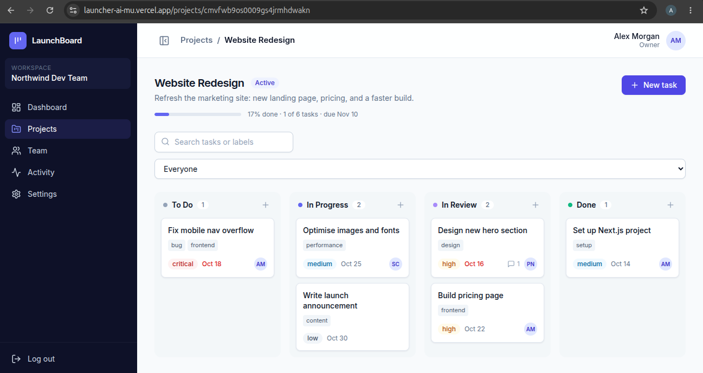
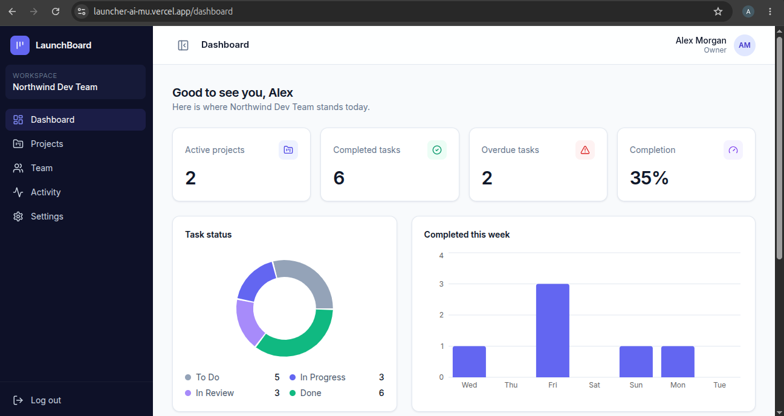
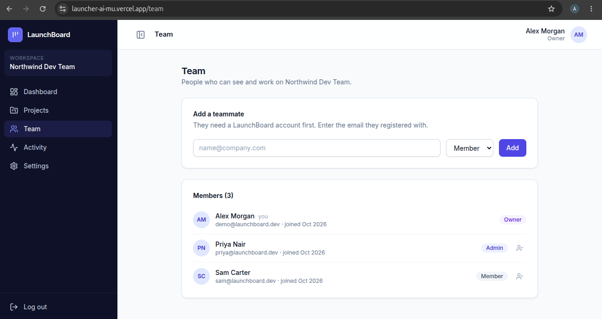
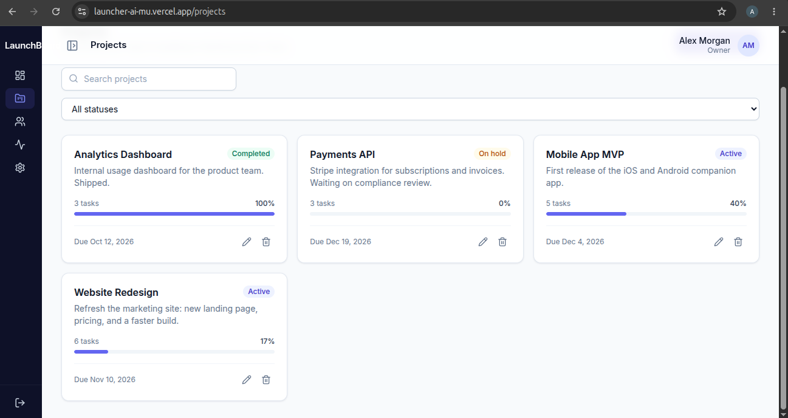
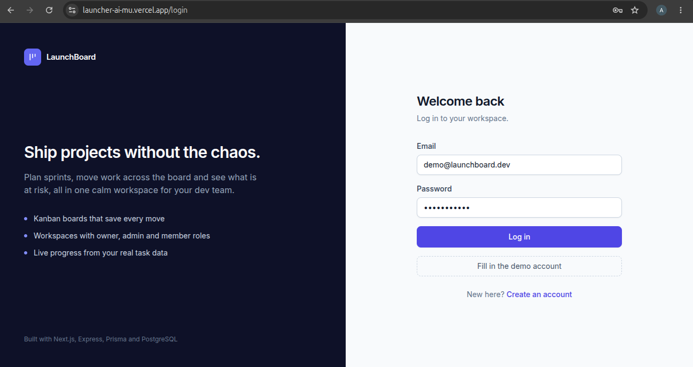
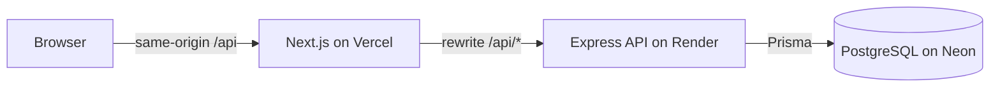
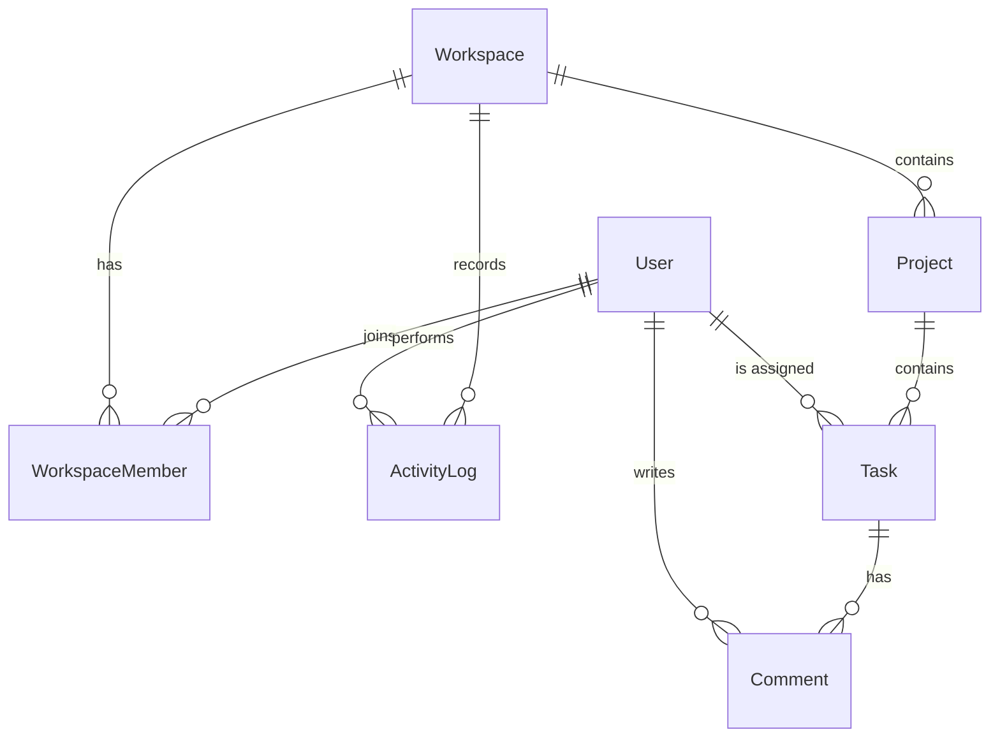

# LaunchBoard

**Project management for small dev teams.** Workspaces, projects, a drag-and-drop Kanban board, live analytics and a full audit trail, built as a full-stack TypeScript app.

**Live demo:** https://launcher-ai-mu.vercel.app
Log in with the demo account: `demo@launchboard.dev` / `password123`
(The API runs on a free Render instance, so the first request after a quiet period can take up to a minute while it wakes up.)



## Why I built it

Small teams end up juggling spreadsheets, chat threads and half-remembered decisions. LaunchBoard keeps projects, tasks, comments and activity in one workspace, with roles so that people only see and change what they should. I built it to practise the parts of a real product that tutorials skip: authorization, data isolation, validation, tests, CI and deployment.

## Features

- **Auth:** registration, login, logout, protected pages. Passwords are hashed with bcrypt and the session lives in an HTTP-only cookie (nothing in localStorage).
- **Workspaces and roles:** Owner, Admin and Member. Admins can add and remove teammates and rename the workspace; only Admins and Owners can delete projects.
- **Projects:** create, edit, delete with confirmation, search, status filter and live progress.
- **Kanban board:** drag tasks between To Do, In Progress, In Review and Done. Moves update instantly, are saved through the REST API, and roll back with a message if the save fails.
- **Tasks:** priority, assignee, due date, labels, comments, search and assignee filter.
- **Dashboard:** active projects, completed and overdue tasks, completion rate, status chart, weekly completion chart, upcoming deadlines and recent activity, all computed from real records.
- **Team, Activity and Settings:** member list, paginated activity log, profile, workspace and password management.






## Tech stack

| Layer | Tools |
|---|---|
| Frontend | Next.js 15 (App Router), React 19, TypeScript, Tailwind CSS, Recharts, dnd-kit, Lucide icons |
| Backend | Node.js, Express 5, TypeScript, Zod, JWT cookies, bcrypt, Helmet, express-rate-limit |
| Database | PostgreSQL, Prisma ORM (migrations and seed script) |
| Testing and CI | Vitest, Supertest, GitHub Actions (typecheck, tests, builds against a real Postgres) |
| Hosting | Vercel (web), Render (API), Neon (database) |

## Architecture



The browser only talks to the Next.js origin. Next.js forwards `/api/*` to the Express server, so the session cookie is first-party and isn't blocked as a third-party cookie.

The API is split into routes (HTTP), services (business logic such as registration), middleware (auth, workspace membership, errors) and Zod schemas for every request body.

## Database design



- A user can belong to many workspaces. `WorkspaceMember` is the join table and carries the role, with a unique `(userId, workspaceId)` pair.
- A project belongs to one workspace, and a task belongs to one project. Tasks do not store a workspace id, so every task query goes through its project's workspace. That is what stops one workspace's data from leaking into another.
- Deleting a workspace or project cascades to its tasks and comments. Deleting a user keeps their tasks and activity but clears the assignee or actor (`SetNull`).
- Indexes cover the hot queries: tasks by project and status, projects by workspace and status, activity by workspace and time.

## Security decisions

- **Authorization is on the server.** The workspace id in the URL is never trusted: middleware looks up the caller's membership and role on every request. A non-member gets `404`, not `403`, so the existence of a workspace is not revealed.
- **Record ids are re-checked against the workspace.** Using your own workspace id with someone else's task id returns `404` (covered by a test).
- Same error message for unknown email and wrong password, rate-limited auth routes, request size limits, Helmet headers, validated environment variables.
- Registration creates the user and their first workspace in one database transaction.

## Local setup

Requirements: Node 22+, Docker.

```bash
git clone https://github.com/azharshaikh7898/Launcher-AI.git
cd Launcher-AI
docker compose up -d                       # PostgreSQL
cp apps/api/.env.example apps/api/.env     # set JWT_SECRET (openssl rand -hex 32)
npm install
cd apps/api && npx prisma migrate deploy && cd ../..
npm run db:seed -w apps/api                # demo data
npm run dev:api                            # http://localhost:4000
npm run dev:web                            # http://localhost:3000
```

### Environment variables

| Variable | Where | Purpose |
|---|---|---|
| `DATABASE_URL` | API | PostgreSQL connection string |
| `JWT_SECRET` | API | Signs session tokens (32+ characters) |
| `WEB_ORIGIN` | API | Allowed frontend origin for CORS |
| `NODE_ENV` | API | `production` enables secure cross-site cookies |
| `PORT` | API | Set automatically by Render |
| `API_URL` | Web | Where Next.js forwards `/api/*` (defaults to `http://localhost:4000`) |

## API reference

All routes are under `/api`. Responses are `{ "data": ... }` or `{ "error": { "code", "message" } }`. `wid` is a workspace id.

| Method | Path | Notes |
|---|---|---|
| POST | `/auth/register`, `/auth/login`, `/auth/logout` | Sets or clears the session cookie |
| GET | `/auth/me` | Current user and workspaces |
| PATCH | `/account/profile` | Update name |
| POST | `/account/password` | Needs current password |
| POST | `/workspaces` | Create a workspace |
| PATCH | `/workspaces/:wid` | Rename (Admin+) |
| GET / POST / DELETE | `/workspaces/:wid/members` | List, add by email (Admin+), remove (Admin+) |
| GET | `/workspaces/:wid/activity` | Paginated activity log |
| GET / POST | `/workspaces/:wid/projects` | Search `q`, filter `status`, `page` |
| GET / PATCH / DELETE | `/workspaces/:wid/projects/:id` | Delete needs Admin+ |
| GET / POST | `/workspaces/:wid/tasks` | Filter by `projectId`, `status`, `assigneeId` |
| PATCH / DELETE | `/workspaces/:wid/tasks/:id` | `PATCH {status}` is the Kanban move |
| GET / POST | `/workspaces/:wid/tasks/:id/comments` | Task comments |
| GET | `/workspaces/:wid/dashboard` | Metrics, chart data, deadlines, activity |
| GET | `/health` | Health check (outside `/api`) |

## Testing and CI

```bash
npm test             # API tests (needs the local Postgres running)
npm run typecheck    # API and web
npm run build:web
```

15 tests cover authentication and cookies, project and task CRUD, validation, workspace isolation, role enforcement, dashboard calculations, account settings and error handling. The GitHub Actions workflow runs migrations against a Postgres service, then typecheck, tests and both production builds on every push.

## Deployment

- **Database:** Neon (use the direct, non-pooled connection string for migrations).
- **API:** Render web service. Build: `npm ci --include=dev && npm run build:api`. Start: `npm run db:deploy -w apps/api && npm run start -w apps/api`. Health check path `/health`.
- **Web:** Vercel with root directory `apps/web` and `API_URL` set to the Render URL.
- After the first deploy, set `WEB_ORIGIN` on Render to the Vercel URL.

Troubleshooting: if login succeeds but you are sent back to the login page, check that `NODE_ENV=production` on Render; if requests return 502 or 504, Render is probably waking up.

## Known limitations and next steps

- Teammates are added by email and must already have an account; email invitation links are not built yet.
- Member roles cannot be changed after they are added.
- Cards can move between columns but cannot be reordered within a column.
- No Calendar view yet.
- The AI project copilot (summaries, risk highlights, weekly reports, with a mock provider so it works without an API key) is planned but not built.
- Auth rate limiting is shared across all visitors because traffic reaches the API through the Vercel proxy.
- The free Render instance sleeps when idle.
